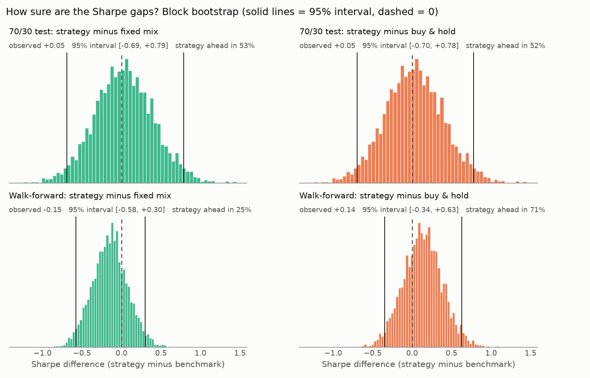
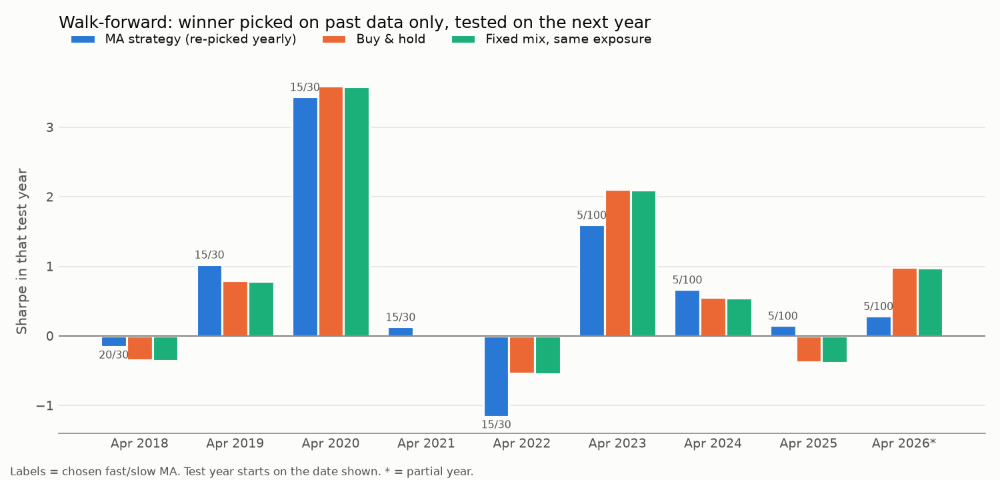
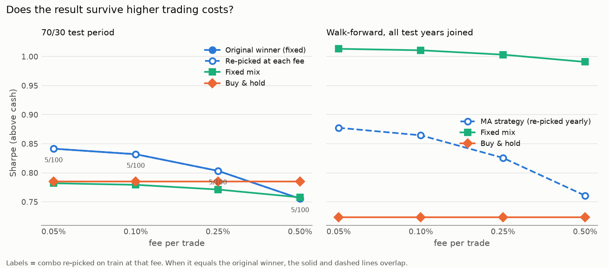

# Does a Moving-Average Trading Strategy Actually Work on Bitcoin?

A backtesting project that tests a classic moving-average crossover strategy on
Bitcoin, using train/test splits, realistic cash interest, a same-exposure benchmark,
and out-of-sample checks on Ethereum and the S&P 500.

**Short answer: no reliable edge.** On unseen Bitcoin data the strategy's Sharpe ratio was
within noise of both buy & hold and a same-exposure fixed mix (95% bootstrap interval for the
gap: roughly -0.7 to +0.8). Settings picked on past data did not predict the future, a
walk-forward test kept changing its pick, and on stocks the signals added nothing beyond
simply holding less. It did lower drawdowns versus buy & hold, but a fixed mix with the same
exposure did as well or better in the walk-forward.

> This is an educational project, not financial advice. No real money was traded.

---

## The strategy

- Compute a **fast** and a **slow** moving average of the daily closing price.
- **Fast above slow** → hold the asset. **Fast below slow** → hold cash.
- Trades act on the *previous* day's signal (no look-ahead).
- **0.1% fee** on every buy and sell.
- While in cash, the money earns the **real 13-week US T-bill rate** of that time
  (Yahoo Finance `^IRX`).

## How it's tested

Most trading-bot tutorials stop at "my backtest made money." This project tries to
answer harder questions:

| Question | How it's tested |
|---|---|
| Are the chosen settings just lucky? | 34 fast/slow combinations. The winner is picked on the **first 70%** of BTC history (train) and judged on the **last 30%** it never saw (test). |
| Did train performance predict test performance? | Rank correlation of every combo's train Sharpe vs test Sharpe. |
| Is the edge real or did the market just change? | Compare the strategy's Sharpe **edge over buy & hold** in train vs test, not raw Sharpe. |
| Is the strategy smart, or just holding less? | Compare against a **fixed mix** (e.g. always 59% BTC / 41% cash, no signals) with the **same average exposure**. |
| Do the settings work elsewhere? | Run the BTC winner, unchanged, on **ETH** and **SPY** (S&P 500 ETF). |

Sharpe ratio here = return **above cash**, per unit of risk, annualized
(365 days for crypto, 252 for stocks).

---

## Results (run on 2026-10-20)

### Bitcoin: train vs test

- Data: 2014-09-17 to 2026-10-20
- Train: 2015-04-05 to 2023-05-03 (picks the winner)
- Test: 2023-05-04 to 2026-10-20 (never seen)
- Winner on train: **MA5 / MA100**

| | Train return | Train Sharpe | Test return | Test Sharpe | Test worst drop |
|---|---|---|---|---|---|
| MA5 / MA100 | 35,537% | 1.55 | 151.2% | 0.83 | -27.5% |
| Buy & hold | 11,333% | 1.16 | 182.2% | 0.78 | -53.1% |

- Sharpe edge over buy & hold fell from **+0.39 (train)** to **+0.05 (test)**: most of the edge disappeared.
- Train-vs-test rank correlation across all 34 combos: **0.09** (train results barely predicted test results).
- Only 1 of 34 combos beat buy & hold on test return (4 of 34 on test Sharpe).

### Is the timing real, or just less exposure?

The strategy was in BTC 59% of the time during the test period, so it's compared
against always holding 59% BTC and 41% cash.

| BTC test period | Return | Sharpe | Worst drop |
|---|---|---|---|
| MA strategy | 151.2% | 0.83 | -27.5% |
| Buy & hold | 182.2% | 0.78 | -53.1% |
| Fixed 59% BTC | 113.5% | 0.78 | -34.1% |

The strategy edged out the fixed mix on all three measures, but the Sharpe gap (+0.05)
is inside the noise: the bootstrap below puts a 95% interval of [-0.69, +0.79] on it.

### Same settings on assets they were never tuned on

| Asset | Period | | Return | Sharpe | Worst drop |
|---|---|---|---|---|---|
| ETH | 2018–2026 (8.4 yrs) | MA strategy | 2,472% | 0.91 | -66.6% |
| | | Buy & hold | 320% | 0.59 | -86.4% |
| | | Fixed 53% ETH | 370% | 0.58 | -63.1% |
| SPY | 1993–2026 (32.9 yrs) | MA strategy | 1,097% | 0.49 | -39.4% |
| | | Buy & hold | 2,865% | 0.51 | -55.2% |
| | | Fixed 74% SPY | 1,567% | 0.51 | -43.3% |

- **ETH:** strong result, but 33 of 34 combos beat buy & hold, so it reflects trend-following
  on ETH in general, not these specific settings. ETH also moves with BTC and its history
  overlaps BTC's training years, so it's weak evidence.
- **SPY:** the real independent check. No edge over a fixed mix. BTC's winning settings
  ranked 16th of 34, exactly in the middle.

> Results change slightly every day as new price data arrives.

---

## What I learned

1. **On the 70/30 test the strategy returned less than buy & hold** (151% vs 182%), with a
   smaller worst drop. Its Sharpe was slightly higher, but the gap is within noise.
2. **Optimizing settings on past data doesn't work here.** The train winner was not the
   test winner, train ranking barely predicted test ranking (0.09), and the walk-forward
   picked three different combos over 9 years. The pick ranked 59% on average among the 34
   combos in its test year, close to the 50% of a random pick.
3. **"Safer" can just mean "holding less."** On stocks, a fixed mix with the same exposure
   did as well as the signals. On BTC in the walk-forward, the same-exposure mix had the
   better Sharpe (1.01 vs 0.86) and the smaller worst drop (-44% vs -64%).
4. **The "dodges crashes" hint is not consistent.** The strategy's worst drop was smaller
   than the mix's on the single 70/30 test but larger in the walk-forward. In the
   April 2022 to April 2023 bear year it did worse than buy & hold (Sharpe -1.16 vs -0.54).
5. **Benchmarks matter more than returns.** Every version of this strategy "made money."
   That alone meant nothing until it was compared against the right alternatives.
6. **Put numbers on the noise.** Every Sharpe gap I measured has a 95% interval that
   includes 0. That means "no evidence of an edge", not "proof there is none".

## Limitations

- One strategy family, daily data, and three related assets. The walk-forward adds more
  splits, but they reuse the same history.
- Not modeled: taxes, slippage and spread beyond the 0.1% fee, exchange risk, and the fact
  that early Bitcoin (2015–2017) was thin and illiquid, so train-period returns (and the
  first walk-forward picks) are unrealistic.
- The strategy made only 22 trades in the test period, so the fee sweep understates how
  much real-world trading costs could matter.
- The fixed-mix benchmark rebalances daily and uses the strategy's actual exposure, so it is
  a control for "just holding less", not something you could have run in advance.
- The verdict thresholds in `backtest.py` (e.g. 0.1 Sharpe) are rules of thumb, not
  statistical tests. The bootstrap intervals below are the statistical check.

---

## Robustness checks (`robustness.py`)

`backtest.py` gives one train/test split and point estimates. `robustness.py` asks how
much those numbers can be trusted. It reuses the backtest's strategy, combos, data and
benchmarks unchanged.

| Check | What it does |
|---|---|
| **Block bootstrap** | Resamples the test days in 20-day blocks (keeping calm and volatile stretches together) 5,000 times. Gives a 95% interval for the Sharpe gap between the strategy and each benchmark. If the interval includes 0, the gap can't be told apart from luck. Block sizes of 5 and 60 days are also checked. |
| **Walk-forward** | Instead of one 70/30 split: pick the best of the 34 combos using only earlier data (at least 3 years), test it on the next year, add that year to the training data, repeat. Every test day is out-of-sample. |
| **Selection bias** | In each walk-forward year, where does the train winner rank among all 34 combos? An average near 50% means picking on past performance is no better than picking at random. |
| **Fee sweep** | Reruns the test period and the walk-forward at 0.05%, 0.1%, 0.25% and 0.5% per trade. The original winner is kept fixed, and a winner is also re-picked at each fee. The fixed mix pays the same fee. |

Results and charts are saved to `results/`.





### Robustness results (run on 2026-10-20, BTC, MA5 / MA100)

**Bootstrap: Sharpe gap, strategy minus benchmark (95% interval)**

| Comparison | Observed | 95% interval | Strategy ahead in |
|---|---|---|---|
| 70/30 test vs fixed mix | +0.05 | [-0.69, +0.79] | 53% of resamples |
| 70/30 test vs buy & hold | +0.05 | [-0.70, +0.78] | 52% |
| Walk-forward (8.6 yrs) vs fixed mix | -0.15 | [-0.58, +0.30] | 25% |
| Walk-forward (8.6 yrs) vs buy & hold | +0.14 | [-0.34, +0.63] | 71% |

Every interval includes 0, and 5-, 20- and 60-day blocks give nearly the same answer.
"Ahead in" is the share of resamples where the strategy came out ahead, not a p-value.

**Walk-forward (9 test years, the last one partial; every day out-of-sample)**

| | MA strategy (re-picked yearly) | Buy & hold | Fixed mix (same exposure) |
|---|---|---|---|
| Return | 1,264% | 999% | 1,412% |
| Sharpe | 0.86 | 0.72 | 1.01 |
| Worst drop | -63.9% | -76.6% | -44.2% |

- The pick beat buy & hold in 5 of 9 years and the fixed mix in 5 of 9.
- It picked 3 different combos (20/30, 15/30, 5/100).
- Average rank of the pick among the 34 combos in its test year: 59% (50% = random).

**Fee sweep (Sharpe, 70/30 test period; walk-forward in the last two columns)**

| Fee per trade | Strategy | Fixed mix | Buy & hold | WF strategy | WF mix |
|---|---|---|---|---|---|
| 0.05% | 0.84 | 0.78 | 0.78 | 0.88 | 1.01 |
| 0.10% | 0.83 | 0.78 | 0.78 | 0.86 | 1.01 |
| 0.25% | 0.80 | 0.77 | 0.78 | 0.83 | 1.00 |
| 0.50% | 0.76 | 0.76 | 0.78 | 0.76 | 0.99 |

MA5 / MA100 was also the winner when re-picked at each fee. At 0.5% the strategy ties the
fixed mix and falls below buy & hold.

---

## Paper trading (live, fake money)

`paper_trade.py` runs the backtest's winning settings (**MA5 / MA100**) forward in time,
once a day after Bitcoin's daily close (00:00 UTC). No real orders are placed.

Each run processes every completed day since the last run and updates three fake
$1,000 portfolios, so the live test is judged the same way as the backtest:

| Portfolio | Rule |
|---|---|
| MA strategy | Hold BTC when MA5 > MA100, otherwise cash earning the T-bill rate |
| Buy & hold | 100% BTC, never trades |
| Fixed 59% BTC | Always 59% BTC / 41% cash (the strategy's average exposure in the backtest test period) |

Results are appended to [`paper_log.csv`](paper_log.csv), one row per day.

```bash
python paper_trade.py            # real run
python paper_trade.py --demo     # try it on fake prices (writes a separate demo log)
```

Design choices:
- Settings were fixed before paper trading started and are not tuned during it.
- Today's unfinished daily candle is ignored; only completed days are used.
- If the computer was off, missed days are caught up, with a warning that those trades
  assume execution at each day's close.
- The log is written all-or-nothing, so a crash can't leave a half-written file.

### How the paper-trading result will be judged

Written down before the results exist, so it can't be bent to fit them. Paper trading
started at the 2026-10-17 close.

- **When:** an interim look at **6 months (2027-04-17)** and the real verdict at
  **12 months (2027-10-17)**. No verdict before 6 months, and no changes to the settings
  (MA5 / MA100, fee, 59% mix) at any point.
- **Compared against:** buy & hold **and** the fixed 59% mix, both in `paper_log.csv`.
  Beating buy & hold alone doesn't count, because the backtest showed a fixed mix with the
  same exposure can match the signals.
- **Measured by:** Sharpe ratio above cash (daily `strategy_value`, `buyhold_value` and
  `fixedmix_value` changes minus the logged `cash_rate_pct`, annualized with 365 days),
  plus total return and worst drop.
- **Verdict at 12 months:**

| Result | Verdict |
|---|---|
| Strategy Sharpe beats **both** benchmarks by 0.1 or more | Promising, **not proven** |
| Within 0.1 of either benchmark, or ahead of only one | No evidence of an edge |
| Behind either benchmark by 0.1 or more | The strategy failed this test |

- **About the 0.1 threshold:** it is a rule of thumb (the same one `backtest.py` uses), not
  a statistical test. The real test is the bootstrap interval: if the 95% interval for the
  Sharpe gap includes 0, the gap can't be told apart from luck, whatever the table says.
  Run the same block bootstrap on the paper-trading daily returns before reading anything
  into a "promising" result.
- **The 6-month look** is mainly a sanity check (is the log complete, do the trades match
  the signals, are costs as expected). It uses the same table, but one half-year is too
  short to conclude anything.
- **Why even a pass is only "promising":** the backtest's bootstrap put a 95% interval of
  roughly ±0.7 on Sharpe gaps over about 3 years. One year of live data is noisier still,
  and it covers a single market regime, so a good year can't separate skill from luck.
  A pass means "keep paper trading", not "trade real money".
- **Not covered:** real slippage, spreads, taxes and missed trades. Paper fills assume
  execution at each day's close.
  
## How to run it

Requires Python 3.10+ (tested on 3.13).

```bash
pip install -r requirements.txt
python backtest.py
python robustness.py     # bootstrap, walk-forward, fee sweep; saves to results/
```

On Windows with multiple Python versions installed, use `py -3.13` instead of `python`.

To check the code works without internet, run it on **fake random prices**
(results are meaningless):

```bash
python backtest.py --demo
python robustness.py --demo     # writes to results_demo/, not results/
```

Settings such as the fee, the moving-average options, the train/test split and the
assets tested are at the top of `backtest.py`.

## Project structure

```
backtest.py        # the full backtest: data, strategy, train/test, benchmarks, report
robustness.py      # bootstrap intervals, walk-forward, fee sweep, charts
results/           # robustness.py output: summary.txt, CSV tables, PNG charts
paper_trade.py     # daily paper trading of the winning settings (fake money)
paper_log.csv      # paper trading record, one row per day (created on first run)
requirements.txt   # Python packages
README.md          # this file
LICENSE            # MIT
```

## Data

Daily prices and T-bill rates come from Yahoo Finance via the
[`yfinance`](https://github.com/ranaroussi/yfinance) package. Yahoo data can have gaps
or occasional errors.

## License

MIT. See [LICENSE](LICENSE).
